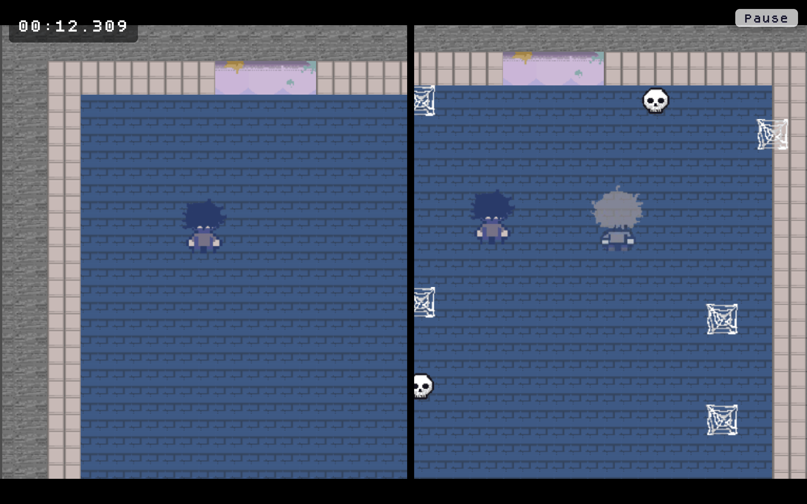
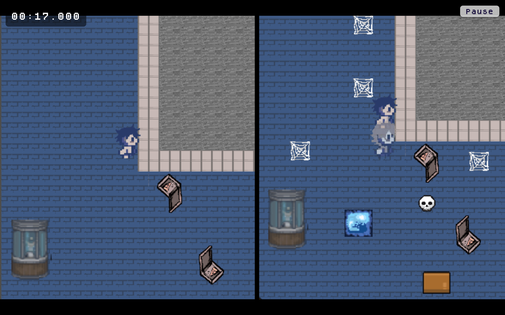
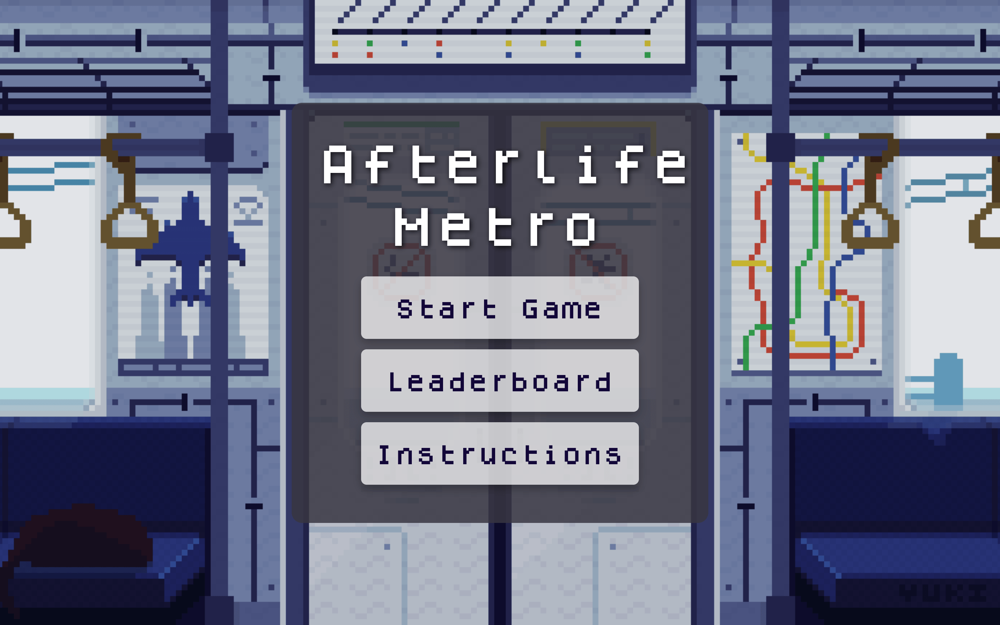
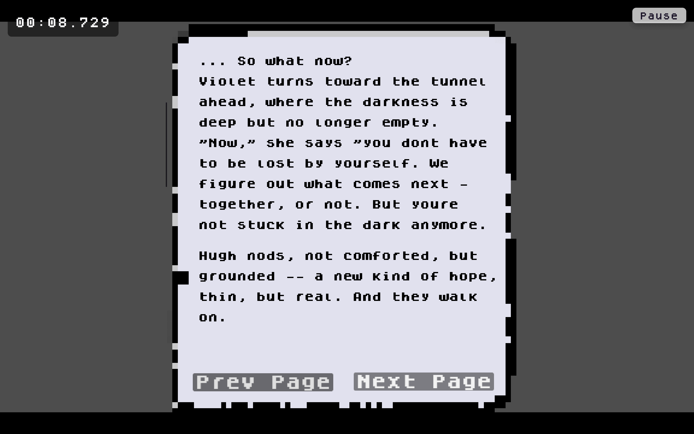
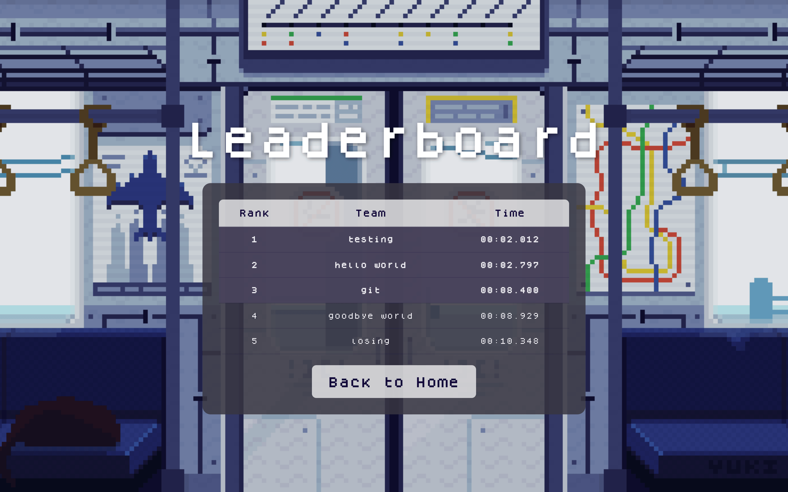
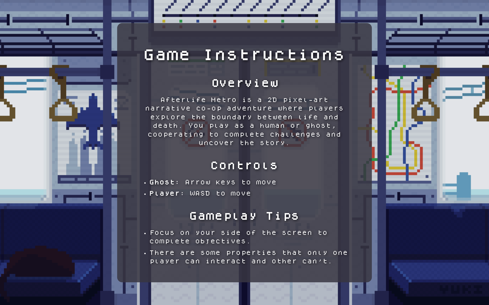
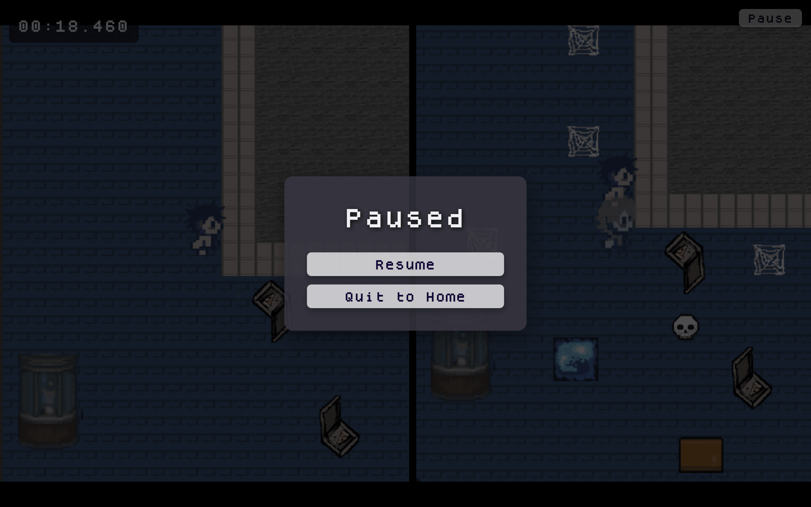

# Afterlife Metro

A local two-player pixel game about a commuter and a ghost who have to cross the same abandoned station together.

Oregon State University, CS 290 (Web Development), Fall 2025. The course [Hall of Fame](https://web.engr.oregonstate.edu/~hessro/teaching/hof/cs290#f25) lists the project as AfterLight Metro.

## What it is

Afterlife Metro is a browser game. An Express server hosts a small site — home, instructions, the game, a thank-you screen, and a leaderboard — and the game itself is a Godot 4.5 project exported for the web and played inside that page.

Two people share one keyboard. The human uses WASD. The ghost uses the arrow keys. The screen is split: each camera follows one character through the same station, and the two views do not draw the same layers. The human's side hides the ghost, the ghost-world tiles, and the key. The ghost's side hides the darkness laid over the human's path.

The run opens on three short pages about Hugh, who died in the station, and Violet, the ghost who stayed. Then the station: three boxes, three pressure plates, and a portal those plates open and close; a key only the human can pick up; and a door that opens once they have it. The end area pauses the game and tells the page the run is over. Stepping into the portal sends the page a completion call of its own. The page keeps the time so a team can save it.

## Screenshots

Captured from the local site (`npm start`, then `homescreen.html`) at 1440×900.

<table>
  <tr>
    <td width="50%">
      
      <br>Split screen. Human view on the left, ghost view on the right.
    </td>
    <td width="50%">
      
      <br>Puzzle room. The ghost view shows a tile and a box the human view does not.
    </td>
  </tr>
  <tr>
    <td width="50%">
      
      <br>Home screen.
    </td>
    <td width="50%">
      
      <br>Story page. Hugh remembers the fall that left him in the station.
    </td>
  </tr>
  <tr>
    <td width="50%">
      
      <br>Leaderboard of the times stored in scores.json.
    </td>
    <td width="50%">
      
      <br>Instructions. Arrow keys for the ghost, WASD for the human.
    </td>
  </tr>
  <tr>
    <td width="50%">
      
      <br>Pause menu over the split screen.
    </td>
    <td width="50%"></td>
  </tr>
</table>

## Features

- Split-screen local co-op on one station, with separate canvas layers for the human view and the ghost view
- Opening dialogue for Hugh and Violet, then the playable station
- Three pushable boxes, three pressure plates, and a portal those plates open and close
- A key and a locked door that only the human can use
- Walk and idle animation for both characters
- An in-page timer, a pause menu, and a way back to the home screen
- A thank-you screen that saves a team name and a time
- A leaderboard stored in `scores.json`, sorted fastest first, and loaded from `/api/scores`

## Stack

- Godot 4.5 and GDScript, exported to HTML5
- HTML, CSS, and browser JavaScript for the site around the game
- Node.js and Express 4 for static files and the score API
- Pixel tiles and character sprites, with Dogica on the site and in the dialogue

## How the pieces fit

`homescreen.html` links to the instructions, the leaderboard, and `game.html`. The game page loads `Afterlife-Metro/Afterlife-metro-godot-Newt.html` in an iframe. That export starts on the dialogue scenes and then `Game.tscn`, which puts the human and the ghost in two `SubViewport`s. Those viewports share one `world_2d`, and a `RemoteTransform2D` on each character keeps that side's camera in step.

When the end area is reached, the game posts `{ type: "gameCompleted" }` to the parent page. Entering the portal calls `window.parent.completeGame()`. Either path stores the timer and opens `thankyou.html`. Saving a score sends `POST /api/scores`. `GET /api/scores` returns the list, fastest time first. Scores live in `scores.json` beside `server.js`.

## Run

From the repository root:

```bash
npm install
npm start
```

Open [http://localhost:3003/homescreen.html](http://localhost:3003/homescreen.html).

`server.js` reads `PORT`. When that variable is unset, the process listens on port 3003.

To edit the game, open `Afterlife-Metro/project.godot` in Godot 4.5. The browser build checked into `Afterlife-Metro/` is what the site plays.

## Team

Draft roles, inferred from commit history and not yet confirmed.

| Name | Role (draft) |
| --- | --- |
| Ally Chen | web UI, leaderboard API, Godot web export, level scenes |
| Simarjeet Kaur | web UI, Godot prototype, game concept |
| Newton Babphavong | Godot gameplay, character animation, level art, web export |
| Nour Alzahraa Alqattan (doornoir) | game art, game concept |
